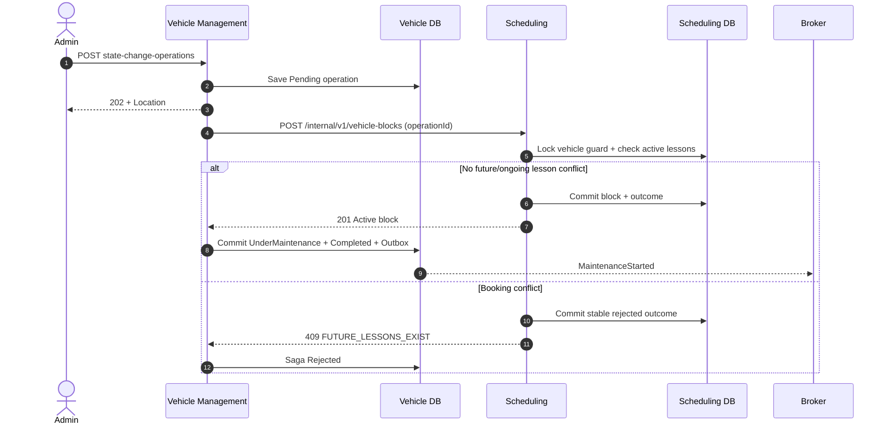

# ADR-007 — Vairas Vehicle State Saga REST Contracts

This document defines the Vehicle Management and Scheduling REST contracts for the vehicle-state Saga. [Implementation coverage](../../README.md#implementation-coverage) is tracked separately.

## Context

Scheduling is the sole owner of `PracticalLesson`, vehicle slot reservations and conflict checking; Vehicle Management is the sole owner of `Vehicle`, operational status (`Active`, `Inactive`, `UnderMaintenance`), allowed licence categories, teacher assignments and `Maintenance`. Their databases are independent. The previously selected **orchestration-based Saga** resides in Vehicle Management; **Scheduling owns a local booking gate**. No 2PC or cross-database queries are permitted.

This ADR formalizes the *planned, immediate, open-ended* maintenance/deactivation workflow and reactivation. It does not yet cover a future interval of downtime because the current `Maintenance` aggregate has a scheduled start, but no formal downtime end. An emergency breakdown is treated separately below.

## Decisions

1. API Gateway routes user-facing state-change requests to Vehicle Management. Its Application Layer persists a Saga operation and returns `202 Accepted`; the work continues via a durable worker. `Location` points to `GET` status.
2. The Saga issues an authenticated **internal REST command** to Scheduling, using a stable `operationId` as an idempotency key. Commands use workload identity with tightly scoped audience/permissions.
3. Scheduling serializes **booking and block creation on the same vehicle guard row**, in a single local database transaction. Its database enforces non-overlapping student/teacher/vehicle reservations as a separate safety net.
4. For planned availability reduction: **block first, then update Vehicle DB**. A committed block and Vehicle status change are not one ACID transaction; recover by repeating/querying known operation IDs. Do not remove a protective block while vehicle state is uncertain.
5. When reactivating: **verify operational readiness, commit Vehicle status `Active`, then release the existing Scheduling block**. Leaving an already-active vehicle temporarily blocked is safe; removing the block before Active is unsafe. Coordinate concurrent operations on the same vehicle using a durable Vehicle-side state-operation guard.
6. `Transactional Outbox` publishes `MaintenanceStarted`, `MaintenanceCompleted`, `VehicleDeactivated` or `VehicleActivated` after local commits. These events are for projections/notifications and do **not** act as the immediate booking gate.
7. All requests must be tenant/vehicle-owner authorized, and internal errors must not disclose other schools' lessons, students, or IDs.

## API map

| Owner | Method/path | Caller | Result | Idempotency |
|---|---|---|---|---|
| Vehicle Management | `POST /api/v1/vehicles/{vehicleId}/state-change-operations` | Authenticated admin | `202 Pending` + `Location`; replay of terminal returns `200` | `Idempotency-Key` header, unique within actor/tenant scope |
| Vehicle Management | `GET /api/v1/vehicles/{vehicleId}/state-change-operations/{operationId}` | Authorized admin | `200` with Saga state | Safe GET |
| Vehicle Management | `GET /internal/v1/vehicles/{vehicleId}/eligibility?branchId&teacherId&category` | Scheduling | `200` with eligibility and vehicle version | Safe GET; check is provisional |
| Scheduling | `POST /internal/v1/vehicle-blocks` | Vehicle Saga | `201` block, `200` replay, `409` conflict | `operationId`, persisted outcome incl. rejection |
| Scheduling | `GET /internal/v1/vehicle-blocks/by-operation/{operationId}` | Vehicle Saga | `200` durable result; `404` not found | Safe GET |
| Scheduling | `POST /internal/v1/vehicle-blocks/{blockId}/release` | Vehicle Saga | `200 Released` | Stable `releaseOperationId` |

**Machine-readable details:** [vehicle-management.openapi.yaml](../vehicle-management.openapi.yaml) and [scheduling-internal.openapi.yaml](../scheduling-internal.openapi.yaml) (both OpenAPI 3.1.0).

## Saga operation states

| State | Meaning |
|---|---|
| `Pending` | Operation persisted but not yet started |
| `Blocking` | Sending/retrying block command |
| `SchedulingBlocked` | Scheduling has committed the block |
| `ApplyingVehicleState` | Applying Vehicle DB transition (or reactivation prerequisites) |
| `ReleasingBlock` | Vehicle Active committed; waiting for Scheduling release |
| `Completed` | Both required service-side changes completed |
| `Rejected` | Deterministic business-rule rejection, no new block created |
| `NeedsRecovery` | Unknown/failed step; durable worker must reconcile |

The exact transition table in `assets/diagrams/vehicle-state-saga.mmd` is a schematic; the implementation must enforce legal transitions with persisted state/version and retries.

## Successful planned maintenance — sequence



A `202` response means *accepted for processing* — it never means maintenance was already started.

## HTTP error contract and retry policy

| HTTP | Condition | Saga behaviour |
|---|---|---|
| `200` / `201` internal | Existing/new block successfully committed | Store `blockId`; move to next step |
| `202` public | State-change operation accepted | Client polls `Location` or replays identical idempotent request |
| `400` | Invalid JSON/parameter | Fix request; do not auto-retry |
| `401` / `403` | No authentication or insufficient permissions | Stop; audit; no auto-retry without credential repair |
| `404` | Object concealed/missing | Stop public operation; **internal status 404 is not proof that earlier POST failed** |
| `409` | Competing operation, future lessons, active block, or different payload under same idempotency key | Persist `Rejected` for a deterministic conflict; require a *new* operation after user resolves issue |
| `422` | Valid shape but impossible business transition | Fix prerequisites, do not auto-retry |
| `429` | Gateway/client rate limit | Client may wait per `Retry-After` and retry idempotently |
| `503` / connection reset / `504` | Dependency unavailable or outcome uncertain | Set `NeedsRecovery`, query internal outcome by `operationId`, retry same command with backoff and jitter; do NOT release block based on timeout |
| `500` | Unexpected server failure | Treat outcome as uncertain if request may have committed; diagnose and reconcile |

Error body uses `application/problem+json` plus stable `code` and `correlationId`. Example:

```json
{
  "type": "about:blank",
  "title": "Vehicle cannot be blocked",
  "status": 409,
  "code": "FUTURE_LESSONS_EXIST",
  "correlationId": "req-b7e28d"
}
```

No future lesson identifiers, students, times at foreign schools, or existence clues should be returned to an unauthorized caller.

## Critical concurrency: lesson booking versus vehicle blocking

**Both operations acquire exactly the same Scheduling database vehicle gate.** When booking gets the gate first, it may commit an overlapping lesson, causing the later *planned* block to fail with `409`. When blocking gets it first, the subsequent booking sees the active block and fails. A standard REST eligibility precheck is not the linearization point.

Illustrative PostgreSQL SQL (not a final schema/migration):

```sql
BEGIN;
INSERT INTO vehicle_booking_guard(vehicle_id)
VALUES (:vehicle_id)
ON CONFLICT (vehicle_id) DO NOTHING;

SELECT vehicle_id
FROM vehicle_booking_guard
WHERE vehicle_id = :vehicle_id
FOR UPDATE;

-- Booking: check no active block and insert lesson/reservations.
-- OR block command: check no relevant existing lessons,
-- insert block and durable command outcome.
-- All done in THIS transaction; handle constraint violations.
COMMIT;
```

Use a database exclusion constraint on resource ID + half-open time range for overlapping student, teacher and vehicle reservations (e.g., PostgreSQL `tstzrange` + GiST). If a lesson reserves several resource types, insert all of them in one transaction. Canonical student/teacher identities and privacy/legal safeguards are necessary for conflicts across schools. Daily student driving limits require their own student/day serialization key. Acquire multiple locks in a stable sorted order to reduce deadlocks.

A changed vehicle eligibility fact beyond status (teacher assignment/category) can also race with booking; **the chosen block Saga currently covers planned status/maintenance changes, not every possible vehicle edit**. Either coordinate those eligibility-reducing edits or explicitly scope the guarantee until a separate ADR resolves them.

## Ambiguous-outcome recovery

1. Vehicle Saga sends `POST /internal/v1/vehicle-blocks` with `operationId=O`.
2. Network times out, but Scheduling might already have committed a block.
3. Saga calls `GET /internal/v1/vehicle-blocks/by-operation/O`.
4. If `200 Active`, continue vehicle status update. If `200 Rejected`, mark operation rejected. If `404` or network unavailable, replay **the identical POST with O**; never invent a new operation ID for a retry.
5. After local Vehicle DB commit + Outbox write, mark completed and notify the user via operation state. If local state still cannot be committed, keep block in place until recovered; never auto-unblock based on a timeout.

For a deterministic `409 FUTURE_LESSONS_EXIST`, Scheduling saves the rejected command outcome keyed by `operationId` even though no block is created. A fresh business attempt **must use a new Saga operation ID** after the existing lessons have been rescheduled.

## Reactivation and compensation

- **Reactivation:** verify no maintenance/inspection prevents operation, serialize the Vehicle state transition, commit `Active` locally, then send a release command for the exact known `blockId` and original `operationId`. If release fails, the vehicle remains conservatively blocked for new lessons and the Saga stays recoverable.
- **Compensation of failed planned change:** if the block was acquired but Vehicle's state transition definitively did *not* apply, a compensating release is allowed only after authoritative verification; if the Vehicle DB outcome is uncertain, keep the block. Never release other blocks for the vehicle.
- **Emergency breakdown:** Vehicle Management may immediately mark the vehicle unsafe and then attempt to block Scheduling and reconcile future lessons. This prioritizes physical safety but does **not** guarantee absence of a fleeting cross-service booking race during network partitions. Strict guarantees would require an additional admission/lease protocol; do not assert that Saga alone solves this.

## Reliability, security, observability

- Persist Saga state and command/result deduplication; enforce at most one conflicting state-change operation per vehicle at a time.
- Use a database transaction + Transactional Outbox for status change and event publishing; broker consumers deduplicate (`eventId`) and handle versions.
- Apply explicit network timeouts, bounded exponential retry/backoff with jitter, DLQ/alerts and manual recovery for prolonged failures.
- Use internal workload-auth tokens with correct issuer/audience/scope; validate end-user school permissions at Vehicle Management before starting a Saga.
- Propagate W3C trace context and `X-Correlation-ID`; use structured logs without personal lesson details.
- Health/readiness endpoints on both services. Track `saga_pending_count`, `saga_needs_recovery_count`, block age, retries, and unexpected mismatches.
- Enforce no cross-database foreign keys or direct reads/writes to another service's storage.

## Acceptance scenarios (proposal)

| # | Test | Expected result |
|---|---|---|
| T01 | Two admins book same vehicle overlapping slots | One commit; second `409` via DB protection |
| T02 | Planned block wins vehicle guard | Future booking rejected |
| T03 | Booking wins and conflicts with immediate planned block | Booking committed; Saga `Rejected`, vehicle remains Active |
| T04 | Repeated identical public POST/idempotency key | Same operation returned; no duplicate Saga |
| T05 | Same idempotency key, altered payload | `409` with stable idempotency mismatch |
| T06 | Scheduling block POST timed out after commit | Status GET / exact retry discovers existing block; no duplicate |
| T07 | Existing lessons conflict with planned block | Deterministic `409` stored; no other school details leaked |
| T08 | Vehicle DB unavailable after successful block | Protective block retained; Saga recovers or reconciles |
| T09 | Reactivate with Scheduling unreachable | Vehicle may become Active but still blocked; eventual safe release |
| T10 | Duplicate/out-of-order broker event | Consumer deduplicates/versions; no booking admission based only on event |
| T11 | Unauthorized school attempts maintenance command | `403`/concealed `404`; zero protected data |
| T12 | Emergency breakdown during booking | Safety override + reconciliation; known non-atomicity documented |
| T13 | Category or teacher assignment changed during booking | Exposes currently open protocol gap; must fail a test only after additional coordination design |

## Open decisions before implementation

1. Whether to support time-bounded maintenance windows: requires formal `EffectiveFrom`/`EffectiveUntil` and a block-overlap policy.
2. How to coordinate eligibility-reducing teacher/category edits with Scheduling.
3. Whether to resolve emergency admission strictly (e.g. a short-lived grant/lease) or treat it as a documented exception with automated reconciliation.
4. Final JWT/client credential architecture, exact permission claims and scope names.
5. Final transaction isolation level, schema constraints and load-tested timeout/retry values.
6. Exact domain meanings of `MaintenanceStatus=InProgress` and `VehicleStatus=UnderMaintenance` during Saga failure/recovery.

## Source alignment

Preserves the existing `scheduling-context.md`, `vehicle-management-context.md`, and previously proposed `vairas-scheduling-vehicle-coordination-adr-003.md`. `VehicleSchedulingBlock`, `VehicleStateChangeOperation`, Saga API endpoints and new state transitions are **proposed additions**, not existing DDD aggregates. Technical contract syntax follows OpenAPI 3.1 and RFC 9110 HTTP semantics; Saga reliability principles follow the distributed-transaction Saga pattern.
