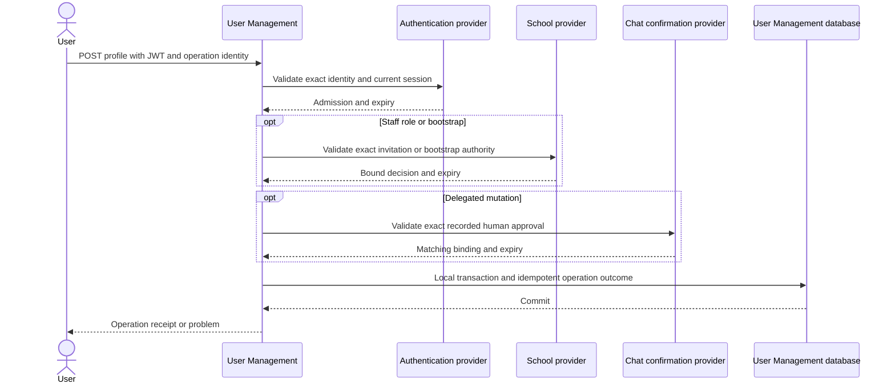
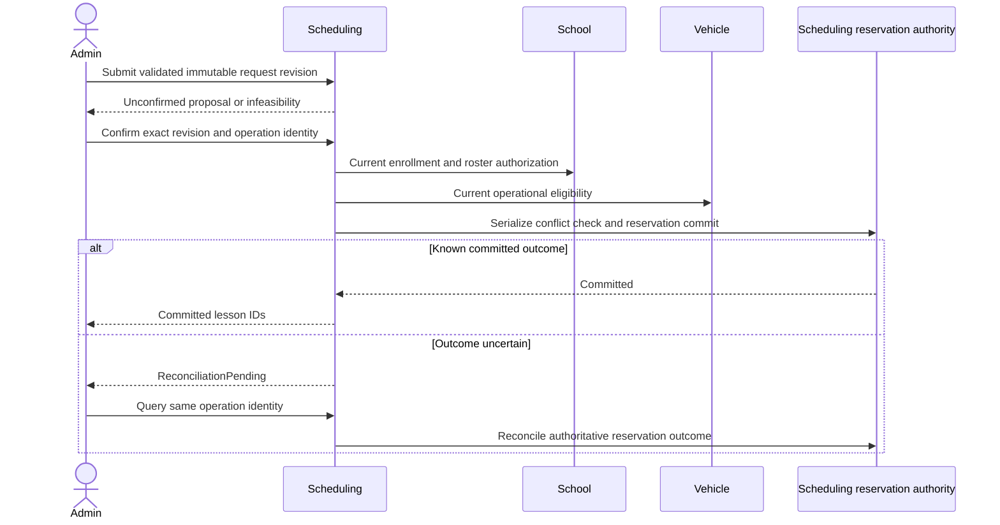
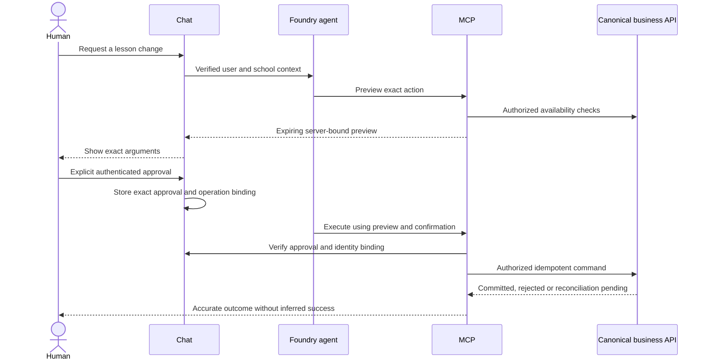
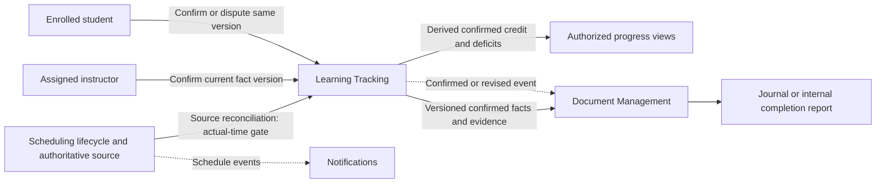

# Integration flows and contract boundaries

The diagrams describe contract boundaries and request flows. Runtime availability is recorded in [implementation coverage](../README.md#implementation-coverage).

## Profile command admission



## Proposal confirmation and uncertain outcome



School and Vehicle HTTP checks are provisional; atomic reservation protection belongs to Scheduling. Cross-school global identity/privacy is an explicit implementation gate. There is no distributed database transaction.

## MCP approval and business parity



Identity delegation is unresolved. This diagram defines required controls, not an operational Foundry token flow. Profile confirmation validation is an implemented consumer contract with proposed provider; booking approval still needs its own business-compatible implementation.

## Training facts and document generation



Scheduling completion alone awards no hours. Scheduling actual-time persistence is included in local migration 002; handlers, Outbox and source reconciliation remain implementation requirements. Document generation completion does not certify readiness, electronic-signature validity or external reporting.

## Theory attendance and confirmation

```mermaid
sequenceDiagram
    actor Teacher
    participant LT as Learning Tracking
    participant Scheduling
    participant School
    Teacher->>LT: Record full Present/Absent roster and minutes
    LT->>Scheduling: Verify current lesson source revision and identities
    LT->>School: Verify retained membership revision for the lesson interval
    LT-->>Teacher: Immutable unconfirmed fact version and aggregate revision
    Teacher->>LT: Review and confirm exact factVersion with expectedRevision
    LT->>Scheduling: Recheck current completed-valid source
    LT->>School: Recheck exact complete historical roster
    LT-->>Teacher: Teacher-confirmed current version
    Note over LT: Present earns full minutes, Absent zero; no student confirmation
    opt Source or attendance corrected
        Teacher->>LT: Append new facts with CAS and audit reason
        LT-->>Teacher: New unconfirmed version; old eligibility blocked
    end
```

The record belongs to one group lesson. A caller cannot confirm a partial roster or transfer a previous version's confirmation. Each participant's programme and enrollment remain independently scoped.
