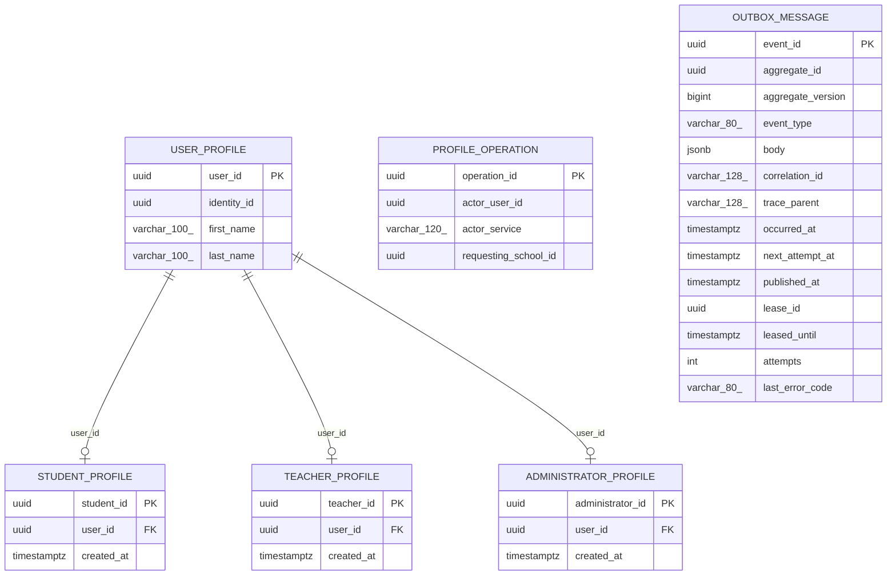

# User Management Database Schema

[DBML source](schema.dbml)

`OUTBOX_MESSAGE` is technical delivery metadata. `aggregate_id` identifies the event's UserId logically; the DDL declares no foreign key. Its partial delivery index and CHECK constraints are documented in the DBML and DDL.
