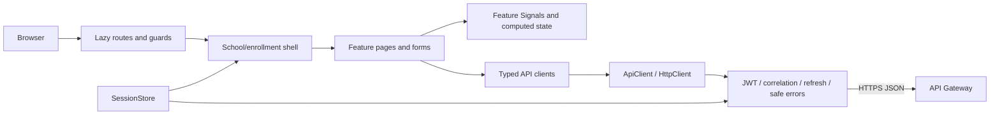

# Frontend architecture

The authoritative application is `Frontend` (moved from `Vairas-Frontend-Tests-Improved/Frontend` on 2026-11-25 at the owner's request). It is an Angular 21 SPA using standalone components, lazy feature routes, Signals/computed state, RxJS and typed reactive forms. PrimeNG uses its standard Aura preset; Tailwind and the existing CSS files provide layout and responsive spacing. There is no custom PrimeNG preset or new design-token layer.

## Components and request flow

`core/session.ts` owns identity, refresh and workspace discovery; backend School roles become UI roles only after authorized workspace discovery. Instructor profile existence alone grants no school permission or Assessor authority. Routes and hidden controls improve navigation; backend authorization remains authoritative.

Access tokens remain in memory. Only the rotating refresh token, session ID and selected school/enrollment survive a reload in per-tab sessionStorage. Restoration rotates the refresh token. Logout/reset clears session/context and cancels pending work. Theme preference is stored separately in localStorage; no authoritative business registry is stored in browser storage.

Feature `Resource` objects track a generation and DestroyRef; late completions after a reload or component destruction cannot replace current state. ApiClient/context cancellation and feature resets protect school/enrollment transitions. Session/context regression tests exercise stale responses; a cancelled response is not a successful mutation. The backend remains responsible for tenant predicates and data minimization.

## Features and forms

Feature folders cover login, dashboard, school administration, invitations/enrollments, programme versions, vehicles, scheduling/planning, practical/theory records, progress/assessments, documents, notifications and assistant conversations. Typed domain models and service clients encode actual Gateway contracts.

Reactive forms validate required fields, selected authorized resources, intervals and revision identities. Mutations prevent duplicate submissions and retain operation identities until the outcome is resolved. Pending/ReconciliationPending is distinct from completed success; a timeout after possible commit requires authoritative recovery rather than a new unrelated operation.

Enrollment configuration checks School's association and Learning's pinned programme. Assessment review sends the exact server invalidation timestamp. Practical credit and readiness are displayed from Learning responses; the client does not independently award credit or approve eligibility. Programme versions are discovered from the backend; an already-loaded programme catalogue is reused to avoid duplicate reads.

## UI, accessibility and errors

Aura supplies light/dark component styles; ThemeStore restores the user's preference. Representative browser checks use 1440x900, 768x1024 and 390x844. The mobile menu is closed after successful navigation. Mobile header metadata no longer forces horizontal overflow. A keyboard skip link explicitly focuses the main region; it does not rely on the base-URL fragment behavior of a routed SPA.

Global feedback contains safe client text, machine codes and correlation references where appropriate. Successful navigation clears obsolete page messages. HTTP 401 may trigger the controlled refresh path; 403 does not elevate permissions, 404 does not disclose foreign records, 409 requires reload/review, and 202 never implies completion. Unexpected failures retain explicit error/loading/empty states.

## Assistant and testing

The UI shows an advisory server preview before a confirmed lesson action. The confirmation checkbox binds the reviewed exact preview; Chat/MCP/owner services validate session, tenant, expiry, payload, replay and current rules. The UI waits for the authoritative execution result. Real-model behavior is distinct from deterministic local model-double integration evidence.

Vitest unit/component/HTTP tests run through official Angular tooling with the official V8 provider and a 70% line threshold. Executable files without tests remain in coverage. Playwright uses accessible locators and the real Gateway for live acceptance; public theme tests are separately identified. Automated checks do not constitute a formal WCAG conformance audit.
