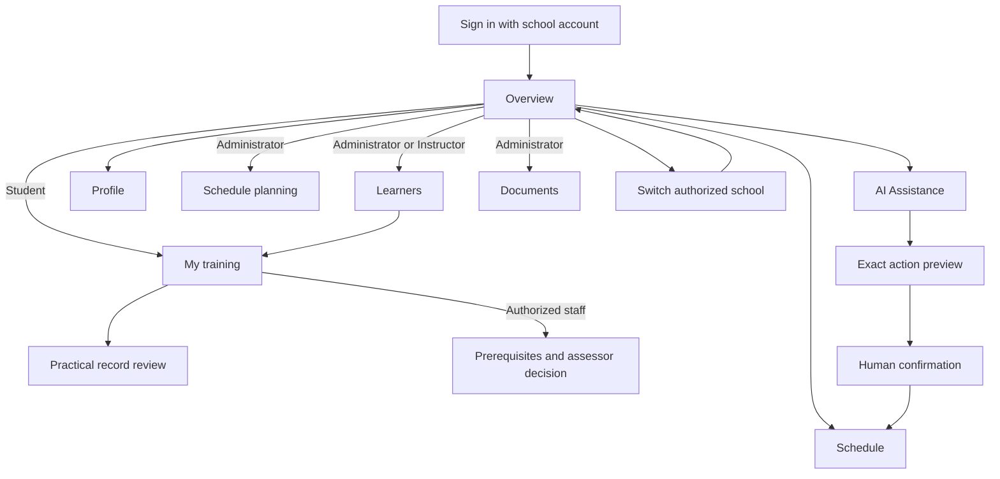
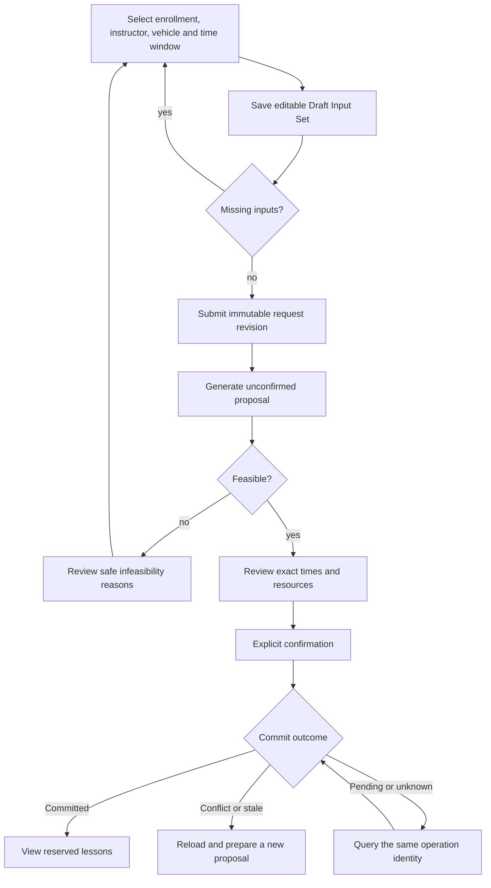
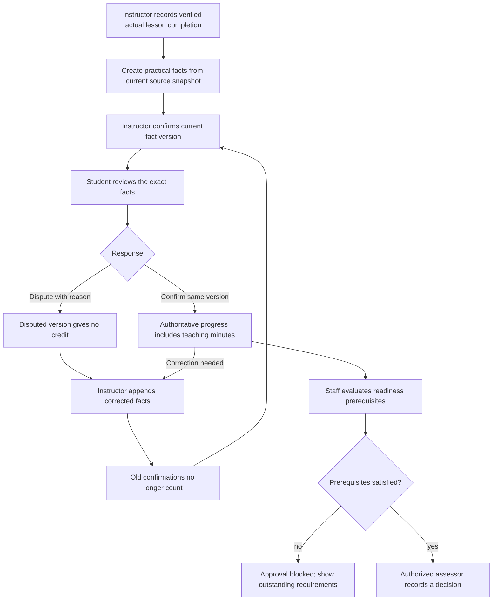
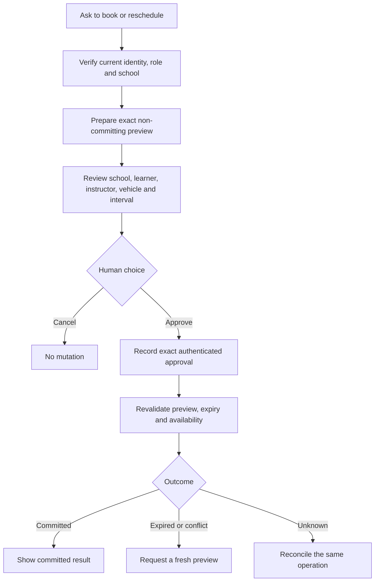

# User flows Vairas

## Навигация

Главная навигация сохраняется на всех рабочих экранах. На mobile sidebar открывается отдельной кнопкой и закрывается после выбора страницы. Student видит свои enrollments; Instructor — доступные назначения; Administrator — текущую школу. Запрещённый route открывает Forbidden, неизвестный — Not Found.

## Сценарий 1: подготовить и подтвердить расписание

Цель Administrator — проверить состав proposal до резервирования ресурсов.

Сохранение draft позволяет вернуться к неполным данным. Submission фиксирует версию. Proposal не является booking. При conflict не показываются чужая школа или чужой календарь. При неопределённом commit новая операция блокируется до выяснения результата.

## Сценарий 2: подтвердить факты и пересчитать прогресс

Цель Instructor и Student — согласовать одну и ту же версию фактов обучения.

Completed lesson, credited practical minutes и readiness — разные состояния. Teaching minutes не выводятся автоматически из planned interval. Instructor вводит факты; Student может оспорить их с причиной. При correction сохраняется история и нужна новая пара подтверждений.

## Сценарий 3: действие через AI Assistance

Цель Administrator — использовать разговорный запрос, сохраняя контроль над записью.

The assistant uses the configured local Chat Backend. It never treats model text as authorization; writes require an exact backend preview and explicit approval. The local model test double is configured behind Chat Backend, outside the frontend runtime.
