# Architecture Diagrams

**Status:** Proposed architecture.

The following diagrams describe the Vairas microservices and MCP-based AI assistant.

[Architecture overview](README.md)

## 01. Bounded Context Map

Business responsibilities, ownership boundaries and logical integration between six business contexts and two supporting contexts.

[Detailed document](assets/diagrams/01-bounded-context-map.md)

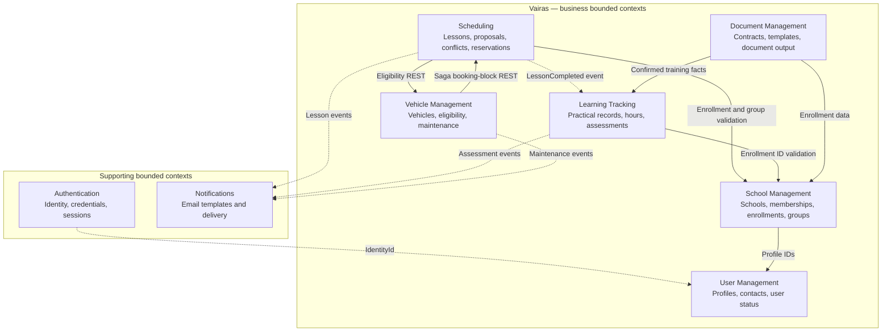

## 02. Container Architecture

Application containers, external entry points, synchronous and asynchronous integration, persistence and observability.

[Detailed document](assets/diagrams/02-container-architecture.md)

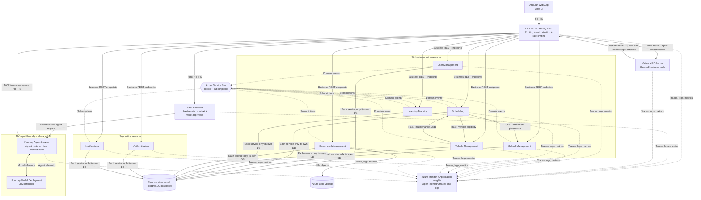

## 03. Service Communications

Inter-service HTTPS/REST calls and asynchronous domain events delivered through Azure Service Bus. Solid arrows denote synchronous calls; dashed arrows denote event publication or consumption.

[Detailed document](assets/diagrams/03-service-communications.md)

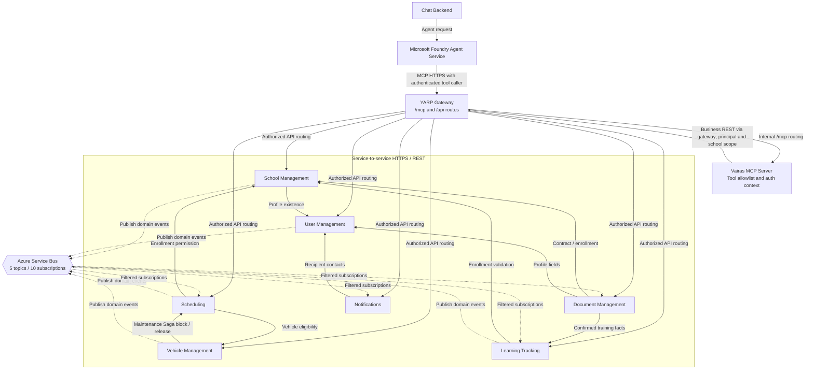

## 04. Azure Deployment

Proposed Azure placement of Foundry, the Chat Backend, gateway, MCP server, business services, storage, messaging and monitoring.

[Detailed document](assets/diagrams/04-azure-deployment.md)

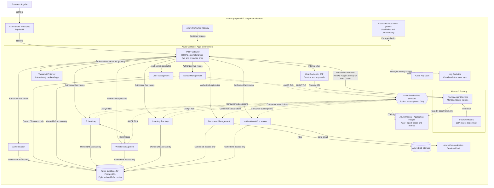

## 05. Service Health and Readiness

Liveness and readiness endpoints for all eight services, the API Gateway and the MCP adapter. Azure Container Apps configures probes per application.

[Detailed document](assets/diagrams/05-health-endpoints.md)

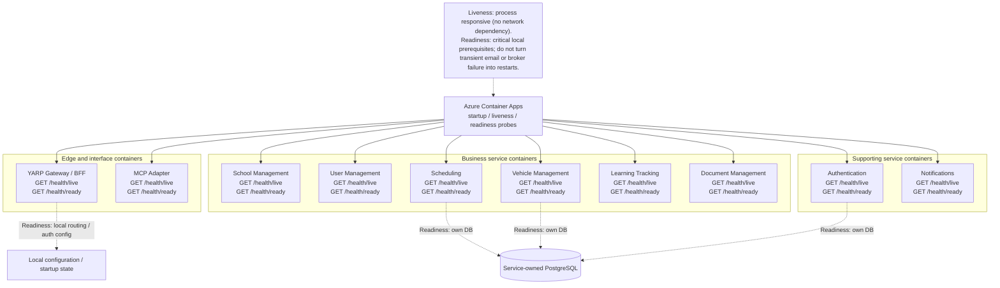

## 06. Correlation ID Propagation

A lesson-creation request carries a correlation ID and W3C tracing context through HTTP calls, the transactional Outbox and asynchronous event processing.

[Detailed document](assets/diagrams/06-correlation-id-propagation.md)

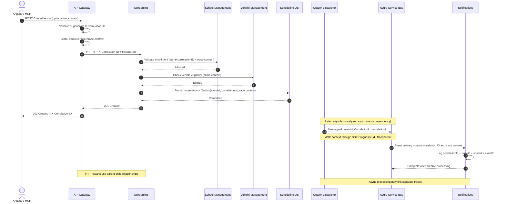

## 07. Distributed Tracing and Observability

Application, agent, model and MCP telemetry connects with business-service spans, asynchronous message processing and centralized monitoring.

[Detailed document](assets/diagrams/07-distributed-tracing.md)

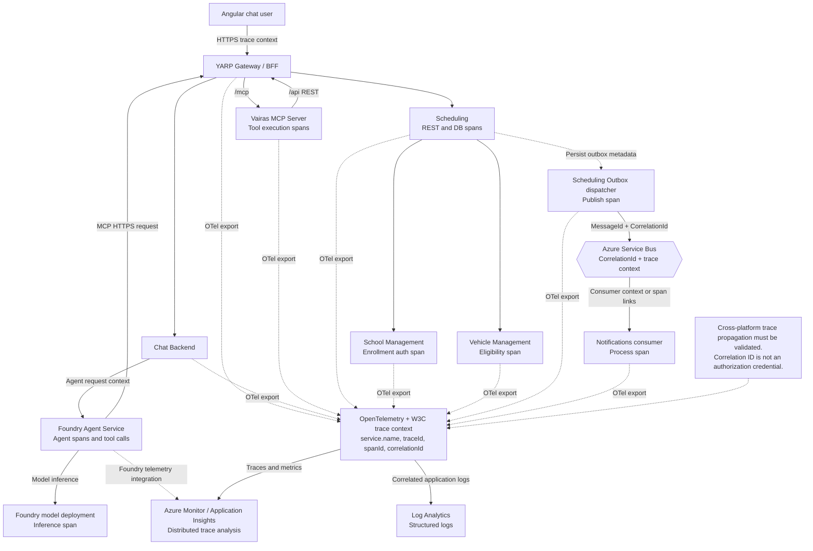

## 08. Database Ownership

Eight independently owned PostgreSQL databases and service credentials on one proposed PostgreSQL Flexible Server. Services access only their own databases; cross-service identifiers are logical references without cross-database foreign keys.

[Detailed document](assets/diagrams/08-database-ownership.md)

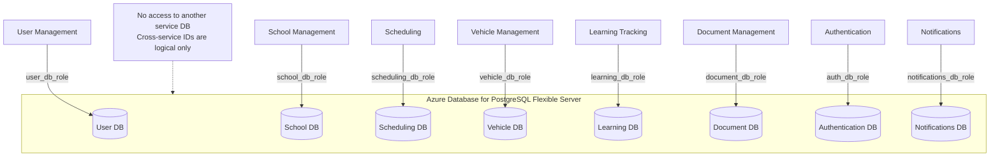

## 09. Planned Maintenance Saga

Proposed extension: Vehicle Management coordinates a maintenance operation with a Scheduling booking block. This illustrates a distributed consistency pattern; fleet maintenance is not a mandatory deliverable of the approved diploma application.

[Detailed document](assets/diagrams/09-maintenance-saga.md)

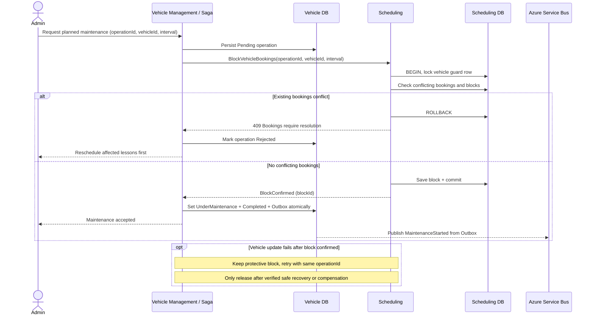

## 10. AI Agent and MCP Architecture

Microsoft Foundry Agent Service orchestrates model inference and controlled MCP tools. Vairas enforces authenticated user and tenant permissions through its gateway and business APIs.

[Detailed document](assets/diagrams/10-ai-agent-mcp-architecture.md)

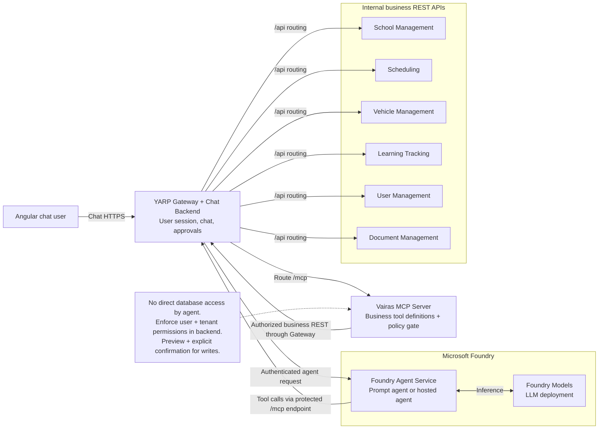

## 11. AI Agent Tool Sequence

A read-only availability request passes through the agent and MCP tools. Booking requires a separate user confirmation validated by the backend before the canonical business API is called.

[Detailed document](assets/diagrams/11-ai-agent-tool-sequence.md)

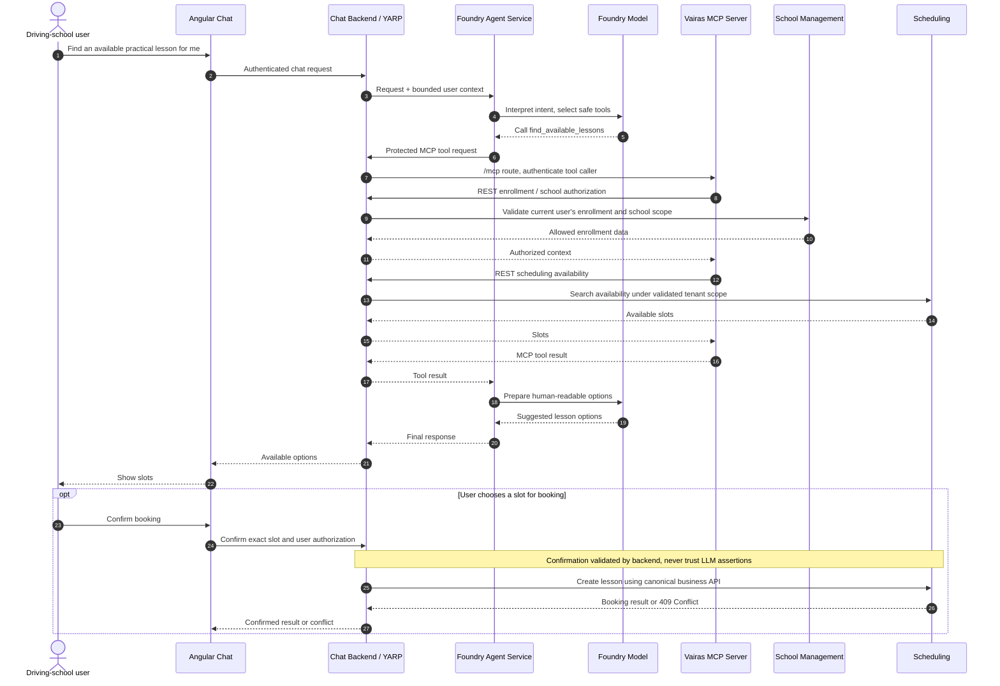
