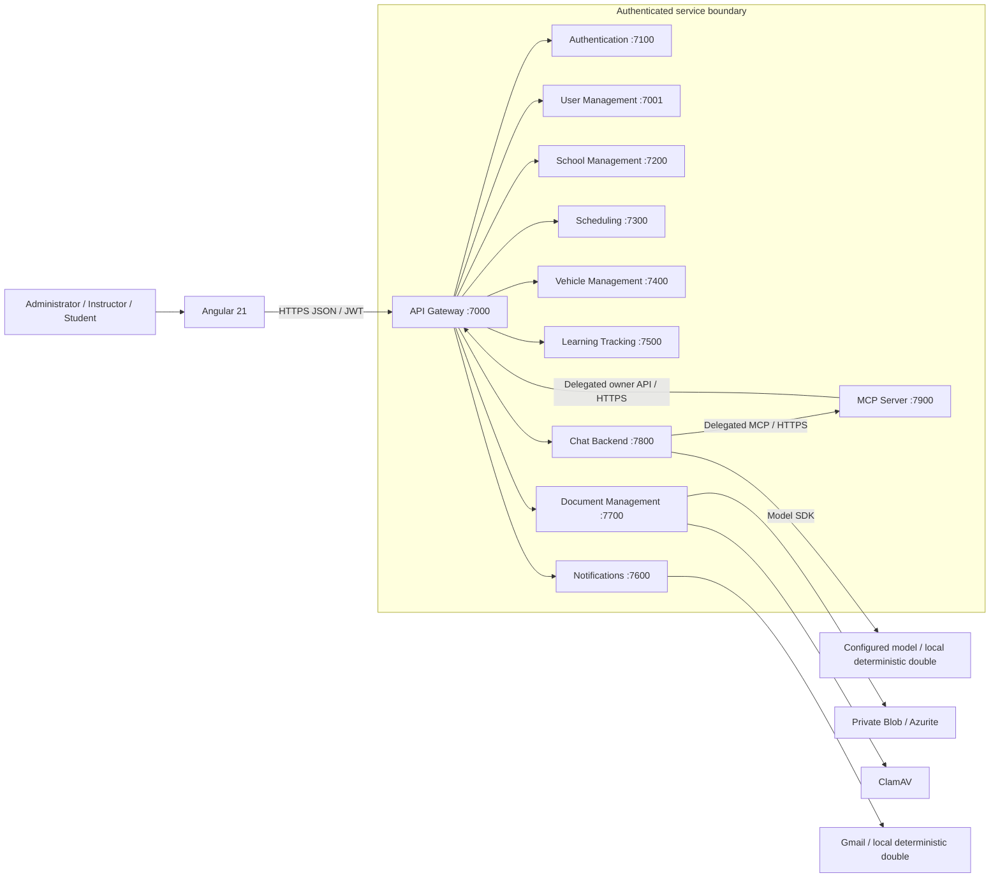
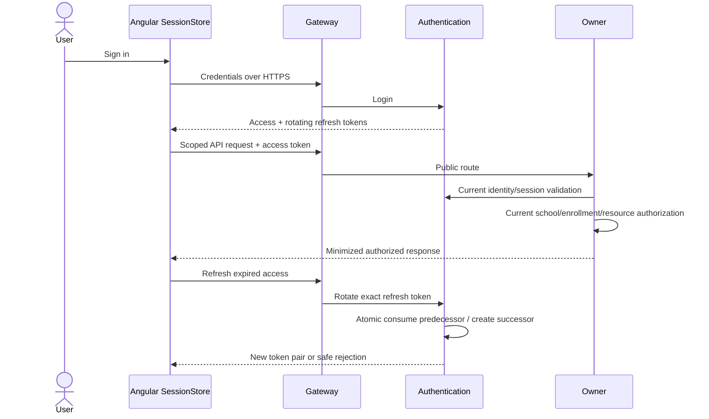
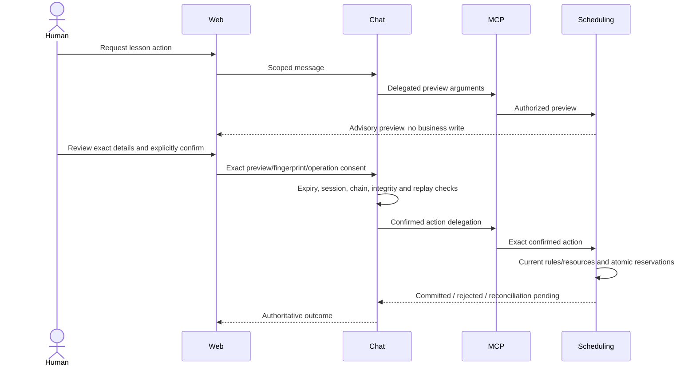

# Implemented Vairas architecture

This is the current local implementation, separate from historical Azure/Foundry proposals. CI/CD, repository orchestration and production deployment are deferred.

## System boundaries

Angular 21 standalone components use Signals, RxJS, typed reactive forms, default PrimeNG Aura and Tailwind. Browser business requests enter the YARP Gateway over HTTPS. Workloads use separate scoped tokens. MCP is an internal server transport, not a public browser Gateway `/mcp` route.

Eleven services retain separate directories/repositories. Gateway and MCP have no business database. Chat owns conversation/preview/execution persistence; the other eight persistent services own independent PostgreSQL databases. Services do not read each other's databases. Cross-service identifiers are logical references, not cross-database foreign keys.

## Service responsibilities

| Service | Owned data and responsibility | Consistency / dependencies |
|---|---|---|
| Authentication | Identity, credentials, sessions, refresh lineage, workload/delegation tokens | Atomic rotation/revocation; identity and session admission |
| User Management | Global profiles, contact information, profile status | Auth and School; inbound idempotency and outbound events; no school membership ownership |
| School Management | Schools, branches, memberships, invitations, groups, enrollments, programme associations | Durable Scheduling gate and Learning authority invalidation; pending recovery preserves prior associations |
| Scheduling | Drafts, immutable requests, proposals, lessons/actual intervals, reservations, rule versions | School, Vehicle, Learning; PostgreSQL exclusion/reservation and atomic batch commit |
| Learning Tracking | Enrollment-pinned programmes, records, credit, historical rosters, assessments, readiness and completion evidence | Scheduling factual sources and School authority; same-version confirmation and current publication decisions |
| Vehicle Management | Vehicles, category eligibility and availability | School permissions and Scheduling coordination; eligibility is not reservation; no fleet maintenance |
| Document Management | Templates/files, jobs, immutable document versions, publication, download grants | School/Learning authority, private storage, scanner and renderer; generation is not Ready publication |
| Notifications | Templates, immutable rendered/contact snapshots, receipts, delivery attempts/work | Owner events, recipient authority and Gmail; Sent means provider acknowledgement |
| Chat Backend | Conversations, exact previews, consent, execution/recovery records | Auth, School, model SDK, MCP and owner transport; model text cannot approve writes |
| MCP Server | Scoped read/preview/confirmed tools, no duplicate business registry | Delegation exchange, School, Gateway owner APIs; deny by default |
| API Gateway | Public routes, limits, delegated request boundary; no business database | Route-specific APIs and owner OpenAPI membership tests |

Service READMEs, `Configuration`, controllers/endpoints, `api`, tests and migrations under `Backend/Vairas.*` supply exact configuration and contracts. See [Communication](../Communication/README.md) and [Database](../Database/README.md).

## Communication and backend structure

Synchronous calls use authenticated HTTPS JSON and bounded timeouts. JWT admission is followed by current profile, school, enrollment and resource checks. Durable command identities distinguish rejection, commit and unknown outcome. A 202/pending response is not completed success.

Local producer topics carry Scheduling lessons to Learning and Notifications; School enrollment events to Learning and Documents; School authority changes to Learning; Learning assessment events to Notifications; Learning evidence/practical changes to Documents; UserDeactivated to School and Scheduling. Vehicle eligibility is checked synchronously. Outbox/inbox handling provides durability/duplicate protection where implemented, without distributed two-phase commit.

API binding delegates to business/application services and domain rules through owned persistence interfaces. Configure* classes register DI, typed validated Options, authentication, dependencies and health checks. Persistence translates provider failures before HTTP handling. Application exception categories contain safe machine codes/messages, without HTTP status values. Unexpected integrity failures return generic INTERNAL_ERROR; logs retain SQLSTATE/constraint names without database values. Client cancellation, dependency timeout and uncertain write outcome are distinct.

## Authentication and confirmation

Chat and MCP confirmed writes are disabled by default. The synthetic profile enables ConfirmedLessonActionsV1. Replicated delegation policies remain synchronized; no shared business-logic library is introduced. Audience, school/session binding, delegation chain, expiry, exact payload, human consent, replay and idempotency remain server responsibilities.

## Scheduling, learning and documents

Editable Draft Input Set → immutable validated request → unconfirmed proposal → revalidation → atomic confirmation. Hard legal and school rules cannot be weakened by soft preferences. Timeout is distinct from proven infeasibility. Availability reads never reserve resources. PostgreSQL protects commit races.

School owns enrollment/group/programme association and its durable Scheduling gate. Learning revalidates that association before pinning the exact programme version. Partial failures remain pending/rejected and recover using the same operation identity. The UI verifies both authoritative outcomes.

Physical completion, validated teaching facts and credited training are separate. Practical credit is zero until instructor and student confirm the same current version. Corrections/disputes invalidate obsolete confirmation/readiness. Theory uses historical rosters, not current membership. Automated readiness and human approval are separate; historical review echoes the authoritative invalidation timestamp.

Document states distinguish Prepared, human-reviewed, PublishedReview and PublishedReady. Immutable artifacts trace to evidence snapshots. Manual external reporting records an administrator declaration, not Regitra acknowledgement. No direct Regitra integration exists.

## Runtime and limitations

The isolated local runtime contains PostgreSQL 17, Service Bus Emulator plus SQL dependency, Azurite, ClamAV, all APIs, HTTPS and synthetic mail/model doubles. Generated Compose, broker settings, credentials, certificates and volumes remain outside repositories. Service READMEs describe their runtime dependencies and configuration.

Synthetic local evidence does not establish production availability, GDPR/legal approvals, real-model quality or cloud deployment. Historical Azure/Foundry/fleet-maintenance diagrams remain proposals where they differ from this document. All measurable NFRs and governance gates require separate evidence.
