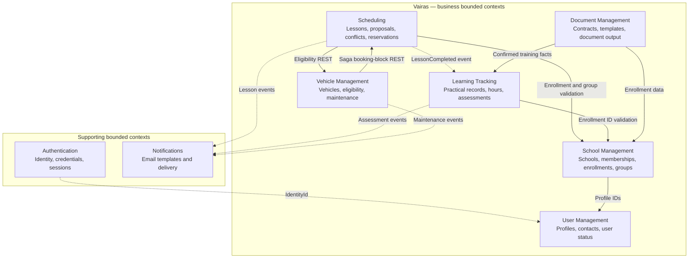

# Bounded Context Map

Business responsibilities, ownership boundaries and logical integration between six business contexts and two supporting contexts.

## Diagram

[Back to architecture overview](../../README.md)
