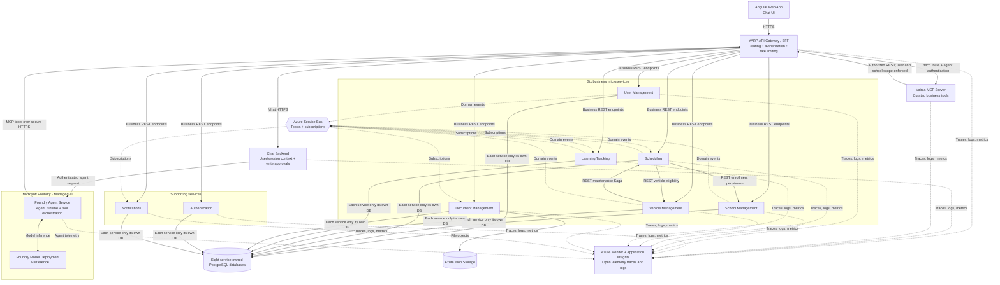

# Container Architecture

Application containers, external entry points, synchronous and asynchronous integration, persistence and observability.

## Diagram

[Back to architecture overview](../../README.md)
