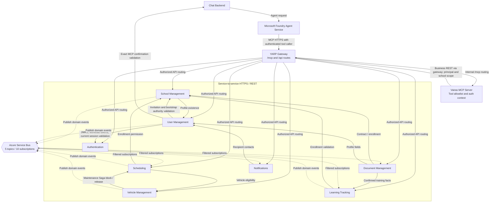

# Service Communications

Inter-service HTTPS/REST calls and asynchronous domain events delivered through Azure Service Bus. Solid arrows denote synchronous calls; dashed arrows denote event publication or consumption.

## Diagram

[Back to architecture overview](../../README.md)

The User Management HTTP clients implement the three added dependency contracts. Authentication, School and Chat providers remain separate implementation requirements. JWT signature checks use cached issuer keys; session admission checks are explicit HTTP calls. No remote write occurs inside a profile transaction.
