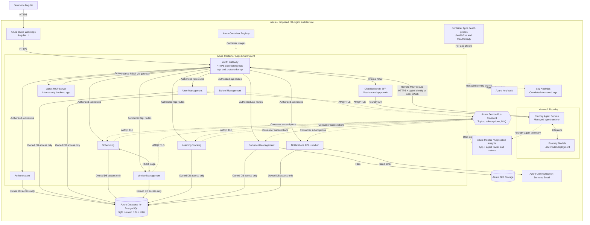

# Azure Deployment

Proposed Azure placement of Foundry, the Chat Backend, gateway, MCP server, business services, storage, messaging and monitoring.

## Diagram

[Back to architecture overview](../../README.md)
