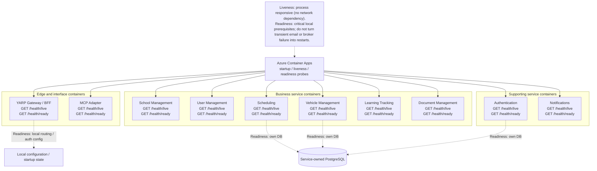

# Service Health and Readiness

Liveness and readiness endpoints for all eight services, the API Gateway and the MCP adapter. Azure Container Apps configures probes per application.

## Diagram

## Design rules

Every independently deployed API service exposes **both**:

| Endpoint | Intended purpose | Expected behaviour |
|---|---|---|
| `GET /health/live` | Liveness | `200` while process can respond; `503` if its core execution is stuck. Do **not** query Service Bus, email or remote services for this probe. |
| `GET /health/ready` | Readiness | `200` when process is ready for its role; `503` when critical local prerequisites are not satisfied, for example unavailable owned DB on a service that needs it for writes. |

The same two paths apply to **Authentication, User Management, School Management, Scheduling, Vehicle Management, Learning Tracking, Document Management and Notifications**, plus YARP Gateway and MCP adapter. Azure Container Apps configures probes **per application**, not at a shared gateway endpoint. Startup probing may use a separately configured startup probe; do not conflate it with readiness or liveness.

For workers (e.g., notification worker or outbox dispatcher), readiness checks must reflect whether the worker can accept/process work, and operational metrics separately track stalled backlog. Avoid permanently restarting applications just because external email or broker is transiently unavailable. Endpoints are **design commitments**, not claims they currently respond.

[Back to architecture overview](../../README.md)
