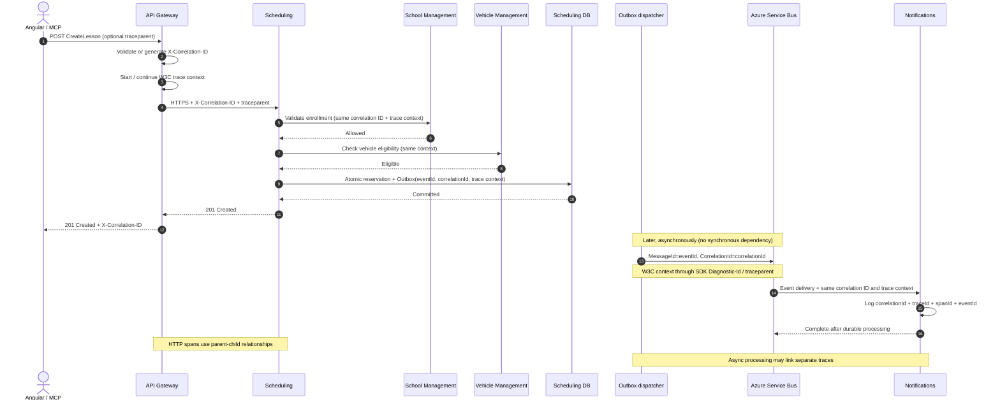

# Correlation ID Propagation

A lesson-creation request carries a correlation ID and W3C tracing context through HTTP calls, the transactional Outbox and asynchronous event processing.

## Diagram

## Design rules

| Boundary | What is propagated |
|---|---|
| Client → API Gateway | Optional `traceparent`; client-provided `X-Correlation-ID` only after format/length validation, otherwise Gateway generates a new one |
| Gateway → REST service | `X-Correlation-ID` and W3C `traceparent` (plus `tracestate` where applicable); authentication/authorization remain independent |
| Service → Service HTTP | Forward same correlation ID; propagate current tracing context through instrumentation |
| Service → PostgreSQL Outbox | Persist `eventId`, `correlationId` and trace context together with the business event |
| Outbox dispatcher → Azure Service Bus | Stable `MessageId = eventId`, `CorrelationId = correlationId`; transport W3C tracing through Azure SDK (`Diagnostic-Id`) or compatible `traceparent` mapping; `eventType` for subscription filters |
| Service Bus → subscriber | Extract correlation ID and trace context, create/continue activity or link tracing span, log `eventId` for deduplication |
| API Gateway → client | Return the correlation ID for support and diagnostics |

**Key distinction:** `correlationId` is the stable logical business/request identifier and useful structured-log field. `traceId` and `spanId` are OpenTelemetry/W3C tracing identifiers and may differ for an asynchronously linked consumer. Do not use either as an authentication token. No email addresses, health data, JWTs or other sensitive payloads should appear in tracing attributes.

[Back to architecture overview](../../README.md)
