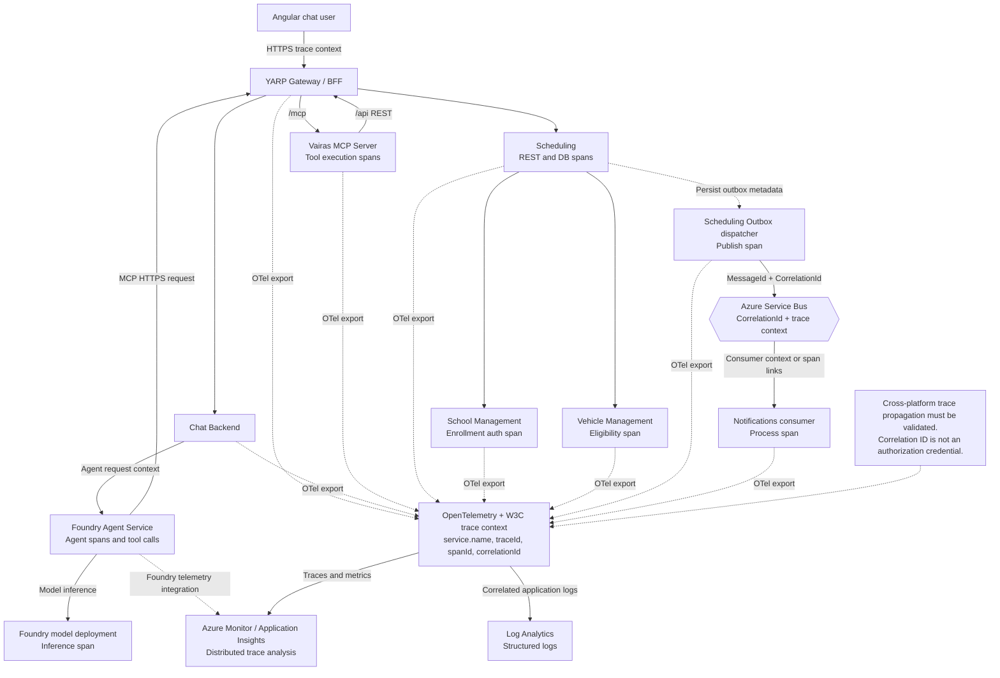

# Distributed Tracing and Observability

Application, agent, model and MCP telemetry connects with business-service spans, asynchronous message processing and centralized monitoring.

## Diagram

## Design rules

- Instrument **Gateway, MCP adapter, Authentication, every business service, Notifications and outbox / subscriber workers** with OpenTelemetry.
- Trace entry requests, outgoing HTTP calls, the Scheduling booking transaction, Saga steps, message publication and message handling. Record producer and consumer causal relationships even if asynchronous traces are separate.
- Each app sets distinct `service.name`; record `traceId`, `spanId`, `correlationId`, and appropriate `eventId` / `operationId` for investigations.
- Export application traces and metrics to **Azure Monitor / Application Insights**; capture structured app logs and Azure Container Apps platform diagnostics in **Log Analytics**. Broker and Container Apps platform metrics feed Azure Monitor alerts.
- Useful monitors: REST p95 latency/error rate, Saga failures/recovery age, outbox age, Service Bus dead-letter count, consumer lag, and scheduling conflict rejects. Define alert thresholds when operational data exists.
- Gateway routing/authentication/rate limiting and **downstream service-level school authorization** remain separate controls. Monitoring is not an access-control decision point.

[Back to architecture overview](../../README.md)
