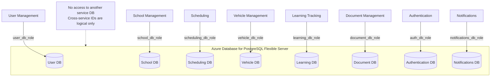

# Database Ownership

Eight independently owned PostgreSQL databases and service credentials on one proposed PostgreSQL Flexible Server. Services access only their own databases; cross-service identifiers are logical references without cross-database foreign keys.

## Diagram

[Back to architecture overview](../../README.md)
