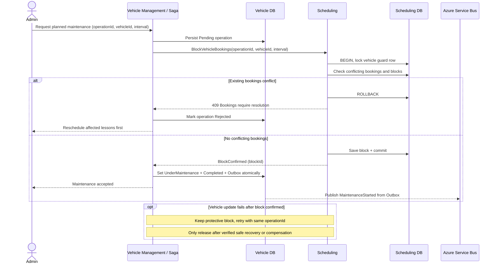

# Planned Maintenance Saga

Proposed extension: Vehicle Management coordinates a maintenance operation with a Scheduling booking block. This illustrates a distributed consistency pattern; fleet maintenance is not a mandatory deliverable of the approved diploma application.

## Diagram

[Back to architecture overview](../../README.md)
