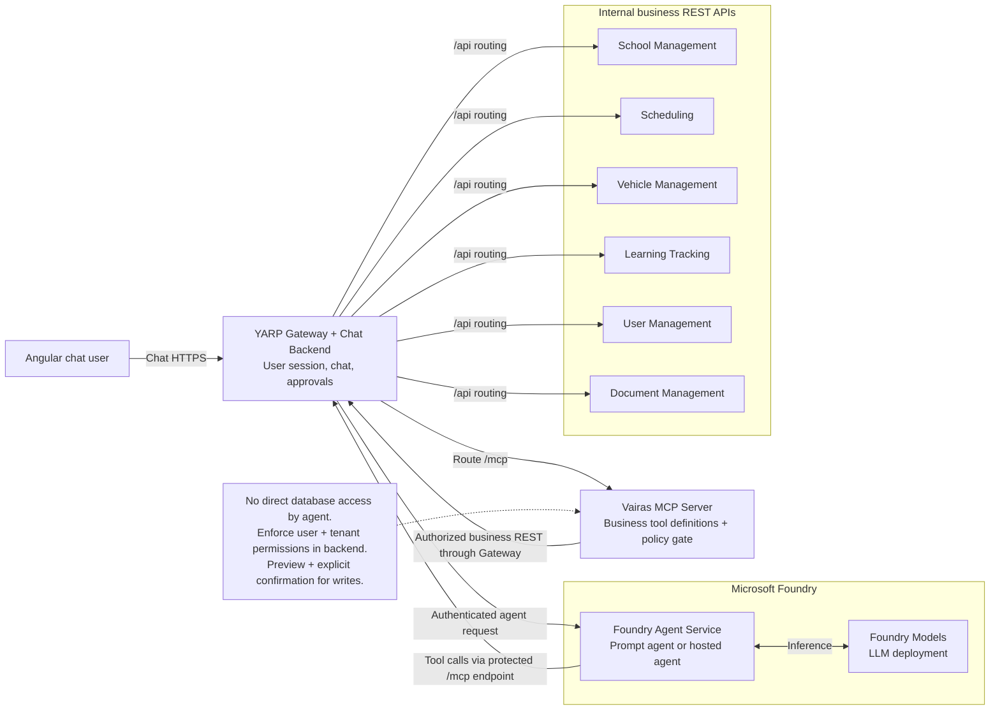

# AI Agent and MCP Architecture

Microsoft Foundry Agent Service orchestrates model inference and controlled MCP tools. Vairas enforces authenticated user and tenant permissions through its gateway and business APIs.

## Diagram

[Back to architecture overview](../../README.md)
