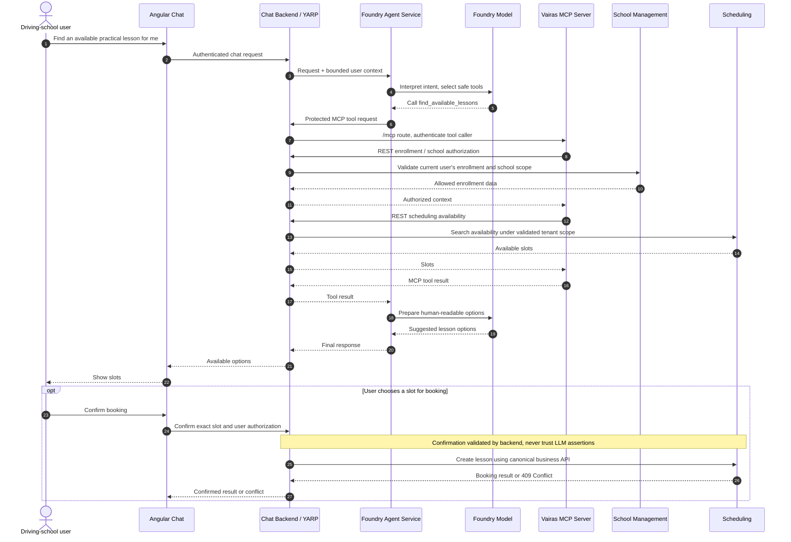

# AI Agent Tool Sequence

A read-only availability request passes through the agent and MCP tools. Booking requires a separate user confirmation validated by the backend before the canonical business API is called.

## Diagram

[Back to architecture overview](../../README.md)
